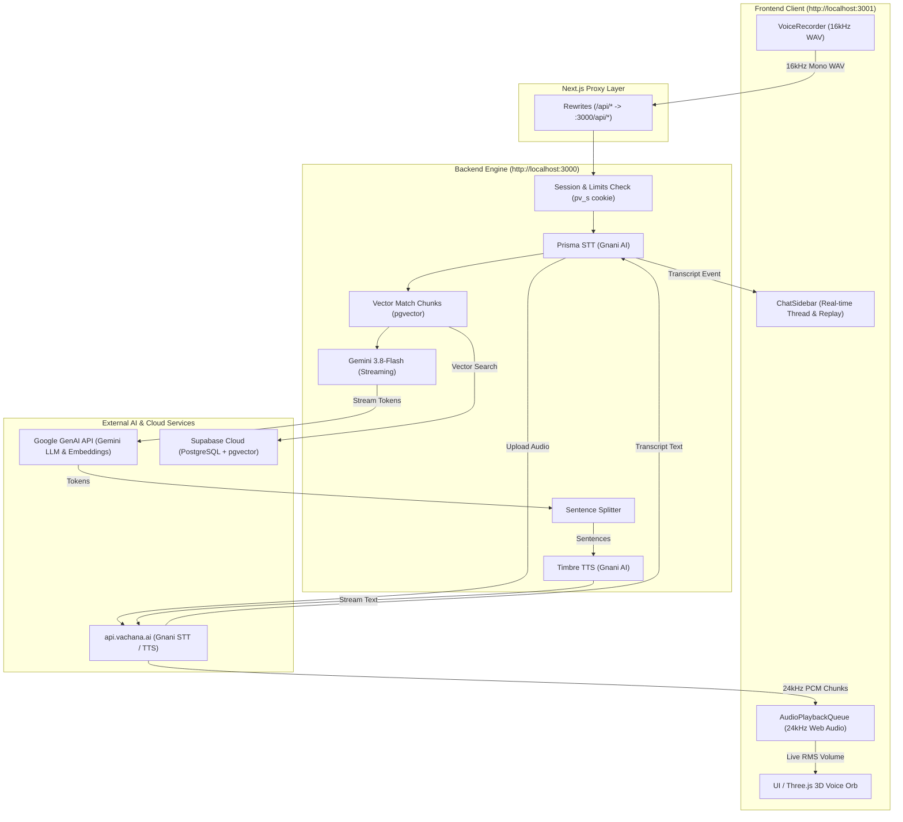

# Persona AI: Comprehensive Architectural & Implementation Report

---

## 1. High-Level System Architecture

The system is architected as a **decoupled, voice-first AI pipeline** running across two active services:
- **Port 3000 (`persona-voice`)**: The AI orchestration backend (Node.js/Next.js) managing STT, RAG knowledge retrieval, LLM streaming, TTS chunking, and security guardrails.
- **Port 3001 (`frontend`)**: The client application (React 19/Next.js) housing the interactive 3D WebGL Shader Orb, real-time chat history sidebar, audio capture/playback engines, and telemetry analytics dashboard.



---

## 2. How Frontend and Backend Are Connected

The frontend (`localhost:3001`) and backend (`localhost:3000`) communicate via a **transparent reverse-proxy rewrite and an NDJSON streaming channel**:

1. **Next.js Reverse Proxy (`frontend/next.config.ts`)**:
   ```typescript
   async rewrites() {
     return [{ source: '/api/:path*', destination: 'http://localhost:3000/api/:path*' }];
   }
   ```
   - **Why this matters**: Browser calls to `/api/turn` and `/api/session` are treated as **same-origin** (`http://localhost:3001/api/...`). This completely eliminates CORS preflight delays, enables HTTP-only session cookies (`pv_s`) to pass natively, and prevents browser security blocks.
2. **Session Authentication & Cookies**:
   - Calling `/api/session` creates a cryptographically signed HMAC token (`sessionId`), stored in the `pv_s` cookie.
   - Subsequent calls to `/api/turn` send this cookie automatically to enforce per-session and per-IP turn limits.
3. **NDJSON Streaming Protocol (`Content-Type: application/x-ndjson`)**:
   - Instead of waiting for the full audio reply to be generated before responding, the backend keeps an open HTTP stream and yields line-delimited JSON events in real time:
     - `{"t":"transcript","text":"..."}` → Instantly appears in the client sidebar.
     - `{"t":"sources","items":[...]}` → RAG knowledge citations.
     - `{"t":"sentence","i":0,"text":"..."}` → Streamed text reply.
     - `{"t":"audio","b64":"...","rate":24000}` → 24kHz raw PCM chunks pushed into the browser's audio queue.
     - `{"t":"timing","stt":..,"rag":..,"llm":..,"tts":..}` → Telemetry metrics.
     - `{"t":"done"}` → Stream completed.

---

## 3. Directory Breakdown: Files & Components

### A. Frontend Application (`/frontend` on Port 3001)

| File / Component | Purpose | How It Is Used |
|---|---|---|
| `frontend/app/page.tsx` | **Main Voicebot Viewport** | Manages bot state (`idle`, `listening`, `transcribing`, `thinking`, `speaking`), integrates the 3D Orb, coordinates barge-in interrupts, auto-saves chat history to `localStorage`, and handles multi-language switching. |
| `frontend/components/ui/orb.tsx` | **WebGL 3D Voice Orb** | High-performance Three.js custom shader rendering an organic, pulsating sphere. Reads `inputVolumeRef` (microphone RMS) and `outputVolumeRef` (speaker RMS) at 60fps inside `useFrame` with zero React re-render overhead. |
| `frontend/components/ChatSidebar.tsx` | **Conversation History Sidebar** | Collapsible left drawer showing user/bot turns with timestamps, language badges, voice/text tags, RAG source citations, and **audio replay buttons**. Allows creating new chats, switching past sessions, and clearing history. |
| `frontend/components/StatusBanner.tsx` | **Accessibility & Status Pill** | ARIA live region (`aria-live="polite"`) announcing state changes to screen readers. Displays animated audio bars and provides a visible UI error banner with a "Retry" button. |
| `frontend/components/ui/ai-chat-input.tsx` | **Multi-Modal Input Bar** | Text input bar with model selector dropdown. Visualizer audio bars are modified to use direct DOM style updates (`barRefs`) to eliminate React 19 update depth loops. |
| `frontend/lib/audio-recorder.ts` | **16kHz Web Audio Recorder** | Captures browser microphone input, calculates real-time RMS for the Orb, detects silence (auto-stops after ~1.5s of silence), and compiles raw Float32 samples into 16kHz mono WAV. |
| `frontend/lib/audio-queue.ts` | **Web Audio Playback Queue** | Decodes streaming base64 24kHz `pcm_s16le` audio chunks, carries over odd bytes, schedules non-overlapping continuous playback, extracts live FFT volume, and saves audio chunks for replay. |
| `frontend/lib/wav-encoder.ts` | **RIFF WAV Encoder** | Pure TypeScript encoder converting Float32 audio arrays into 16kHz 16-bit mono RIFF WAV Blobs expected by Gnani Prisma STT. |
| `frontend/lib/api.ts` | **Centralized API Client** | Contains `initSession()`, `streamTurn()`, and friendly error message translators. Uses `NEXT_PUBLIC_BACKEND_URL` with proxy fallback. |
| `frontend/app/dashboard/page.tsx` | **Telemetry Dashboard** | Comprehensive Bento grid view tracking turn latency milestones, net quota, Gnani STT/TTS benchmarks, and session activity logs. |

---

### B. Backend Engine (`/persona-voice` on Port 3000)

| File / Component | Purpose | How It Is Used |
|---|---|---|
| `persona-voice/app/api/turn/route.ts` | **Core Turn Pipeline** | Validates multipart payload, performs session/IP rate limiting, runs Gnani STT, retrieves Supabase vector chunks, invokes Gemini LLM stream, feeds SentenceSplitter, and streams Timbre TTS audio chunks over NDJSON. |
| `persona-voice/app/api/session/route.ts` | **Session Gateway** | Issues authenticated session cookies (`pv_s`), verifies Turnstile tokens, and returns public persona configurations. |
| `persona-voice/lib/gnani.ts` | **Gnani AI Integration** | REST client for Prisma STT (`POST /stt/v3`) and SSE client for Timbre TTS (`POST /api/v1/tts/sse`). Handles PCM audio configuration and voice selection. |
| `persona-voice/lib/llm.ts` | **Gemini LLM Client** | Invokes `@google/genai` with `gemini-3.8-flash` to stream tokens, enforces spoken sentence constraints, and incorporates RAG knowledge context. |
| `persona-voice/lib/db.ts` | **Database & Persona Loader** | Loads persona configs (`personal-assistant.json`, `shop-assistant.json`, `tamil-companion.json`) with slug aliases (`saphire`, `rahu`, `maragatham`) and executes Supabase RPC `match_chunks`. |
| `persona-voice/lib/sentence-splitter.ts` | **Incremental Sentence Parser** | Buffers incoming LLM tokens and yields complete spoken sentences as soon as punctuation (`.`, `?`, `!`) is reached, allowing TTS synthesis to start while the LLM is still generating subsequent sentences. |
| `persona-voice/lib/security/limits.ts` | **Rate Limiter** | Sliding-window limiter tracking turn counts per session and per IP address. |

---

## 4. Models, Providers & Language Matrix

| Persona / Model Display Name | Language Code | Backend Persona Slug | Gnani STT Model | Gnani TTS Voice & Model | Core Reasoning LLM |
|---|---|---|---|---|---|
| **Saphire** | `en-IN` (Indian English) | `personal-assistant` / `saphire` | Prisma STT v3 (`en-IN`) | Kaveri (`timbre-v2.5`, 24kHz) | Gemini 3.8-Flash |
| **Rahu** | `hi-IN` (Hindi / Hinglish) | `shop-assistant` / `rahu` | Prisma STT v3 (`hi-IN`) | Poorvi (`timbre-v2.5`, 24kHz) | Gemini 3.8-Flash |
| **Maragatham** | `ta-IN` (Tamil / Tanglish) | `tamil-companion` / `maragatham` | Prisma STT v3 (`ta-IN`) | Kaveri (`timbre-v2.5`, 24kHz) | Gemini 3.8-Flash |

- **Vector Embedding Model**: `gemini-embedding-001` (768 dimensions).
- **Vector Database**: Supabase PostgreSQL + `pgvector` with HNSW index indexing local domain knowledge (project schedules, shop prices, Chennai transit).

---

## 5. Security Posture & Vulnerabilities

> [!WARNING]  
> Current configurations are tuned for seamless local development and require hardening prior to public production deployment:

1. **Hardcoded Secrets in Development Files**:
   - `persona-voice/.env.local` contains active credentials:
     - `SUPABASE_SERVICE_ROLE_KEY`: Grants full admin read/write bypass across all database tables.
     - `GEMINI_API_KEY`: Unrestricted API key for Google GenAI.
     - `GNANI_API_KEY`: API key for speech synthesis and recognition.
   - **Fix**: Move production secrets to environment managers (Vercel Secrets, Doppler, or AWS Secrets Manager). Restrict Supabase to Row Level Security (RLS) policies instead of relying on the service role key.
2. **Relaxed Origin & Dev Bypasses (`origin.ts` & `limits.ts`)**:
   - `checkOrigin()` and rate limiters automatically bypass checks when `process.env.NODE_ENV !== 'production'`.
   - **Fix**: Ensure production deployments set `NODE_ENV=production` and populate `ALLOWED_ORIGINS` with the exact production domain.
3. **In-Memory Rate Limiter Leakage**:
   - `limits.ts` currently stores rate limits in Node.js process memory (`new Map()`). If running multi-instance (e.g. serverless functions or container clusters), state is not shared across nodes.
   - **Fix**: Connect Upstash Redis by filling `UPSTASH_REDIS_REST_URL` and `UPSTASH_REDIS_REST_TOKEN` in `.env.local`.
4. **Client Audio Size & DoS**:
   - While `turn/route.ts` rejects audio blobs greater than 1.5MB, audio decompression is performed in memory.
   - **Fix**: Enforce strict MIME-type validation (`audio/wav`) and cap max audio duration to 20 seconds.

---

## 6. Known Persistent Issues & Limitations

1. **Gnani Cloudflare 504 Gateway Timeouts & 429 Concurrency Limits**:
   - **Issue**: Gnani's SaaS endpoint (`https://api.vachana.ai`) occasionally experiences Cloudflare 504 Gateway Timeouts during upstream spikes, and free/trial API keys reject concurrent requests with `429 Only 1 active request is allowed at a time`.
   - **Mitigation Implemented**: The frontend catches STT timeouts, informs the user with a friendly banner, and provides a one-click "Retry" button. If TTS chunks fail to stream from Gnani, the client automatically falls back to browser `window.speechSynthesis` so audio is never silent.
2. **Browser Autoplay Restrictions**:
   - **Issue**: Chrome and Safari block audio contexts from playing until the user has performed a direct user interaction (click/tap) on the page.
   - **Mitigation Implemented**: The audio playback context resumes on the user's first click on the Voice Orb or send button.
3. **Deprecated Three.js Modules Warning**:
   - The Three.js dependency emits a warning in the console: `THREE.Clock: This module has been deprecated. Please use THREE.Timer instead.` (This is a non-breaking library warning from `@react-three/fiber`).

---

## 7. Pipecat AI Evaluation (`pipecat-ai/pipecat`)

### What is Pipecat?
[Pipecat](https://github.com/pipecat-ai/pipecat) is an open-source Python framework for building voice agents and multimodal conversational apps using WebRTC and WebSockets. It orchestrates pipelines across audio I/O, VAD (Voice Activity Detection), STT, LLM, and TTS with built-in turn-taking and interruption handling.

### Will It Help Our Project?

| Criterion | Our Current Architecture (Node.js/Next.js) | Pipecat AI Architecture | Verdict |
|---|---|---|---|
| **Ecosystem & Stack** | Pure TypeScript (Node.js + Next.js App Router). | **Python-only** (`asyncio`, PyAudio, WebRTC). | ⚠️ **Stack Mismatch**: Adopting Pipecat requires introducing a separate Python daemon microservice alongside Node.js. |
| **Transport Protocol** | HTTP/2 multipart upload + NDJSON streaming. Zero state on server, runs on serverless or lightweight containers. | **WebRTC / WebSocket full duplex**. Requires persistent stateful servers and media SFU infrastructure (e.g. Daily.co or LiveKit). | ⚠️ **Infra Overhead**: Higher deployment complexity and operational cost. |
| **STT/TTS Provider Integration** | **Gnani AI (Prisma STT + Timbre TTS)** for specialized Indian languages (Tamil, Hindi, Indian English). | Built-in support for OpenAI, Cartesia, ElevenLabs, Deepgram, Azure, AWS. **No native Gnani AI service module.** | ❌ **Custom Plugin Required**: We would have to write a custom Pipecat `STTService` and `TTSService` class in Python for Gnani. |
| **Interruption / Barge-in** | Client-side: Web Audio API instantly halts playback when user taps mic or presses <kbd>Esc</kbd>. | Server-side: Real-time WebRTC VAD detects user speech while audio is streaming and automatically terminates downstream TTS generation. |  **Advantage for Pipecat**: True open-mic natural duplex conversation. |
| **Latency** | ~1200ms TTFB (turnaround from silence to first audio chunk). | Sub-600ms TTFB with WebRTC streaming STT + streaming TTS. |  **Advantage for Pipecat** (only if streaming STT provider is used). |

### Implementation Recommendation:
- **For Version 1 (Current Project)**: **Do NOT adopt Pipecat**. Our current TypeScript stack is running end-to-end, Gnani AI is already integrated in Node.js, and Pipecat's lack of native Gnani AI drivers plus its Python requirement would require rewriting the backend orchestration.
- **For Version 2 (Future Open-Mic Duplex Upgrade)**: If upgrading to an open-microphone, always-listening WebRTC assistant with Daily.co or LiveKit, Pipecat is an exceptional choice—provided a custom Python Gnani gRPC adapter is created.

---

## 8. Gnani AI Repositories Evaluation

### 1. `Gnani-AI/API-service`
- **Repository Scope**: Contains documentation and reference scripts for Gnani's **enterprise gRPC gateway** (`asr.gnani.ai:443`).
- **Protocol**: Bidirectional streaming gRPC using Protocol Buffers (`speech.proto`).
- **Authentication**: Requires a corporate customer certificate (`cert.pem`), an account `token`, and an `accessKey`.
- **Applicability to Our Project**:
  - Our current key (`vach_live_...`) is designed for Gnani's REST SaaS portal (`https://api.vachana.ai`). The enterprise gRPC gateway rejects standard REST API tokens.
  - If we upgrade to enterprise gRPC credentials, this repository provides the exact protobuf contracts required to implement `@grpc/grpc-js` streaming in Node.js for sub-300ms interim word-by-word transcription.

### 2. `Gnani-AI/AndroidSpeechToText`
- **Repository Scope**: Native Android (Java/Kotlin) demonstration SDK for embedding Gnani STT directly into Android mobile applications.
- **Applicability to Our Project**:
  - **Not directly usable** in our web application since our frontend is Next.js / React running in the browser.
  - **Relevant for Mobile Roadmap**: If we package Persona AI into a native Android app via React Native, Flutter, or native Android, this repo provides the reference implementation for Android audio hardware capture and streaming.

---

## 9. Summary & Recommended Action Plan

```
┌─────────────────────────────────────────────────────────────┐
│                       CURRENT STATUS                        │
│  • Backend: Port 3000 (Node.js/Next.js)                     │
│  • Frontend: Port 3001 (React 19 / Three.js 3D Orb)         │
│  • Languages: English (Saphire), Hindi (Rahu), Tamil (Maragatham) │
│  • End-to-End: Working via Next.js Proxy & NDJSON Stream    │
└─────────────────────────────────────────────────────────────┘
```

1. **Immediate Priorities**:
   - Keep current resilient client architecture (NDJSON streaming + browser TTS fallback on Gnani timeout).
   - Migrate in-memory rate limiting to Upstash Redis before scaling to multiple server instances.
   - Enforce production environment isolation for secret credentials.
2. **Next Milestone**:
   - Link `/dashboard` to live Supabase usage tables.
   - Add Redis/Supabase audio phrase caching for common greetings to achieve instantaneous sub-50ms voice playback.
